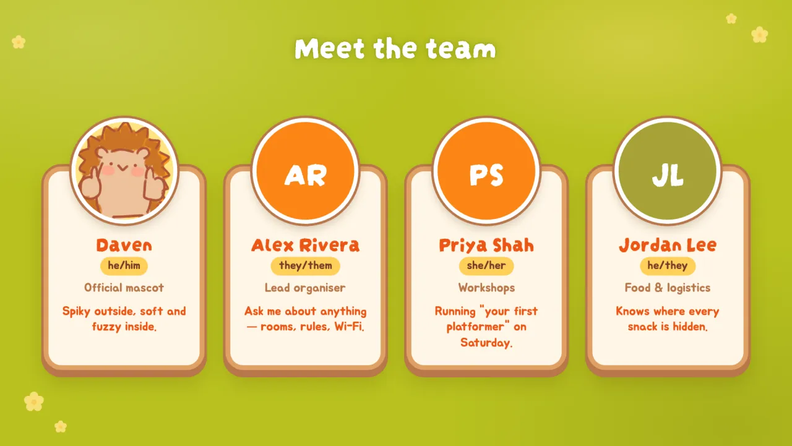
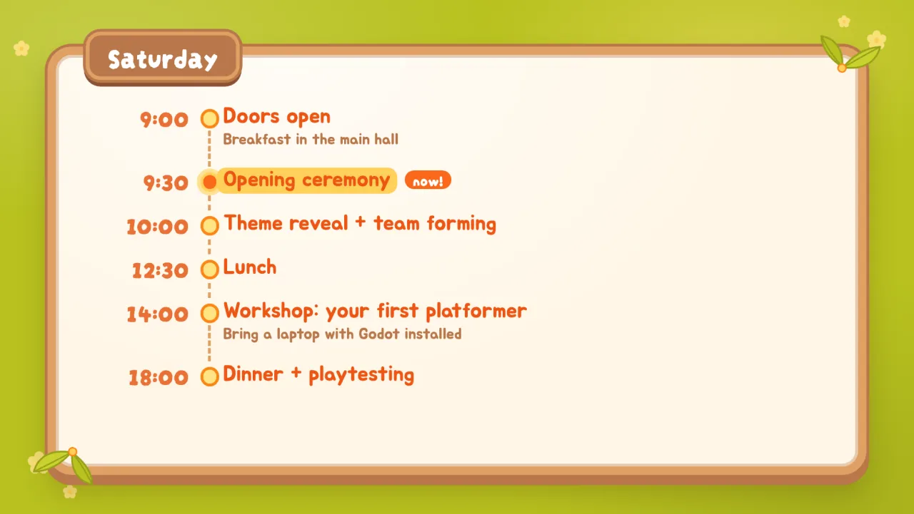
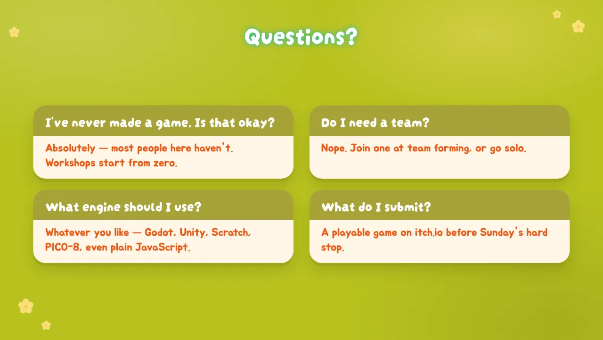
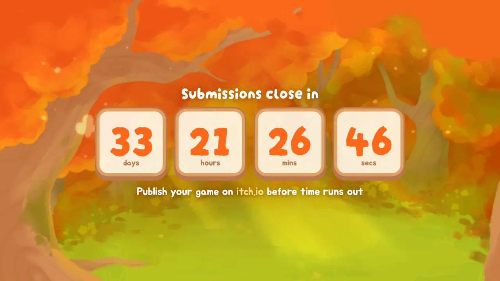
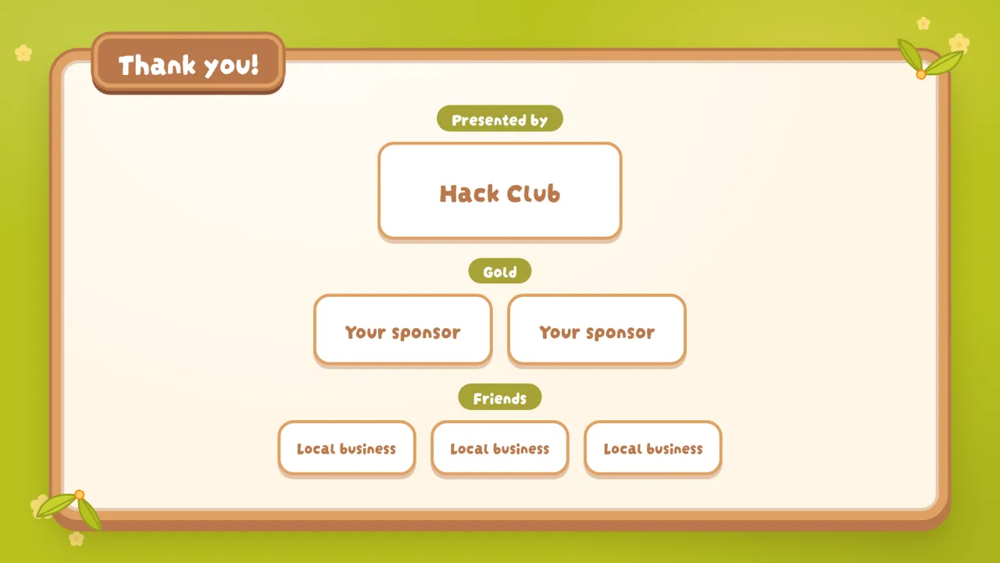

# slidev-theme-haven

> [!NOTE]
> This theme was generated with AI (Claude), directed and reviewed by a human.

A cosy autumn-forest [Slidev](https://sli.dev) theme for **Hack Club Haven** game jams, built from
[haven.hackclub.com](https://haven.hackclub.com/) and the official Haven Brand Guide.


- **Type:** Darumadrop One for headings, Jua for body text (the brand guide's fonts), bundled
  so decks work offline
- **Palette:** the brand guide's official colours, plus a few supporting shades from the site
- **Motifs:** wooden signboards with leaf corners, name plaques, speech bubbles, yellow
  highlighter, orange picnic cards, the spiral notebook, and Daven the hedgehog peeking in
- **21 layouts** covering a whole event: openers, agendas, people, workshops, FAQs, a live
  countdown, sponsor walls and a send-off

> Community-made for Haven organisers — not an official Hack Club project.

## Install

```bash
npm install slidev-theme-haven
```

```md
---
theme: haven
---

# Welcome to Haven!
```

Requires Slidev 53 or newer. Slidev will also offer to install the theme the first time you use
`theme: haven`.

Want to see every layout? Clone the repo and run the demo deck ([example.md](example.md)):

```bash
npm install && npm run dev
```

## Layouts

Grouped roughly in the order you'd use them in a deck. Every layout name below is what goes in
`layout:`; the screenshots come straight from the demo deck.

### Openers

#### `cover`
Autumn forest, Haven logo, hedgehog peeking in.
Frontmatter: `logo: white | orange | watercolor | false`, `hedgehog: false`, `background`.


#### `intro`
Speaker card with a round avatar. Frontmatter: `avatar` (defaults to Daven).


#### `people`
A grid of people on mini signboards. `image` is optional — without one you get coloured
initials. Columns are picked automatically (override with `columns`).

```yaml
layout: people
people:
  - name: Alex Rivera
    pronouns: they/them
    role: Lead organiser
    image: /photos/alex.webp
    description: Ask me about anything.
```



#### `bubbles`
Forest + hedgehog; every paragraph or list item becomes a speech bubble.
Frontmatter: `background`, `hedgehog: false`.


### Structure & emphasis

#### `section`
A big signboard on the village-path map. Frontmatter: `kicker`, `background`.


#### `statement`
Glowing white headline framed by the site's sparkle marks. Frontmatter: `background`.


#### `fact`
A huge butter-yellow number over the forest. Frontmatter: `background`.


#### `quote`
Daven says it: the blockquote is one big speech bubble, a paragraph after it is the attribution.
Frontmatter: `background`, `hedgehog: false`.


### Everyday content

#### `default`
Meadow with a cream signboard. The first `# h1` becomes the brown name plaque. Tables, lists and
code blocks are all styled to match.


#### `two-cols`
Signboard split in two (`::right::`).


#### `image-right` / `image-left`
Signboard plus a taped polaroid. Frontmatter: `image`, `caption`, `tilt`.


#### `center`
A small centred signboard — good for a single question or a reveal.


### Event logistics

#### `agenda`
A timeline on a signboard. `now: true` highlights the current item; more than 6 items split into
two columns (override with `columns`).

```yaml
layout: agenda
items:
  - time: "9:30"
    title: Opening ceremony
    note: Main hall
    now: true
```



#### `notebook`
The site's spiral notebook: the default slot fills the left page, `::right::` fills the right.
Frontmatter: `heading` (white glowing title outside the book). Best with two `<Step>`s per page.


#### `cards`
Orange picnic-blanket backdrop for `<HavenCard>` grids. Frontmatter: `background`.


#### `faq`
Question cards in the style of the site's FAQ. Frontmatter: `faqs` (list of `q`/`a`), `columns`
(default 2), `background`.



#### `countdown`
A live countdown over the forest — handy on a second screen during the jam. Shows `done` once
the time passes; the slide body appears underneath.

```yaml
layout: countdown
until: 2026-11-15T14:00:00
label: Submissions close in
done: Pencils down! 🎉
```



### Closers

#### `sponsors`
A thank-you wall grouped by tier (in the order tiers first appear; earlier tiers get bigger
tiles). `logo` and `url` are optional — without a logo the name is shown.

```yaml
layout: sponsors
sponsors:
  - name: Hack Club
    tier: Presented by
  - name: Acme
    logo: /sponsors/acme.svg
    tier: Gold
```



#### `end`
Forest + excited hedgehog. Frontmatter: `background`, `hedgehog: false`.


## Components

```md
<mark>highlighted</mark>  or  <Marker>highlighted</Marker>
<HavenCard title="Scrapyard" image="/photos/x.webp" variant="orange|cream|green">body</HavenCard>
<PersonCard name="Alex Rivera" pronouns="they/them" role="Lead organiser" image="/photos/alex.webp">Blurb</PersonCard>
<Step n="1" title="Find a team">Teams of up to 4.</Step>
<HavenButton href="https://haven.hackclub.com" arrow>Sign up!</HavenButton>
<Bubble tail="left|right|none">Speech bubble</Bubble>
<Polaroid src="/photos/x.webp" caption="hi" tilt="-3" max-height="10rem" />
<Sticker tilt="-4">new!</Sticker>
<Daven variant="peek|excited|thumbs|pixel" bottom="0" right="40px" width="160px" flip />
```

> `==mark==` syntax isn't enabled in Slidev by default — use `<mark>`.

## Palette

From the Haven Brand Guide → Fonts + Colors. Available as CSS variables (`--haven-lime`, …) and
UnoCSS colours (`text-haven-lime`, `bg-haven-banana`, …).

| Role      | Name           | Hex       | Token           |
| --------- | -------------- | --------- | --------------- |
| Primary   | lime green     | `#B8C11F` | `haven-lime`    |
| Primary   | carrot orange  | `#FC8616` | `haven-carrot`  |
| Secondary | banana yellow  | `#F9DD60` | `haven-banana`  |
| Secondary | pumpkin orange | `#E87136` | `haven-pumpkin` |
| Secondary | faded orange   | `#DFA063` | `haven-faded`   |
| Secondary | burnt umber    | `#783D2B` | `haven-umber`   |
| Secondary | lucky green    | `#A8A237` | `haven-lucky`   |

Supporting shades from the site: body text `#ED5615` (`haven-orange-deep`), sign-up button
`#FA681B` (`haven-orange`), highlighter `#FFD059` (`haven-yellow`), signboard wood `#B8774A`
(`haven-brown`), FAQ teal `#2CBF90` (`haven-teal`).

## Brand rules worth knowing

From the Haven Brand Guide's social media guidelines:

- No AI-generated images.
- Every logo must keep the "Hack Club" mark — all three bundled logos do.

## Notes

- Slidev 53.0.0's own CSS breaks the CSS minifier during `slidev build`. The theme ships a
  [vite.config.ts](vite.config.ts) that turns CSS minification off, which Slidev applies to your
  deck too, so builds work out of the box.
- The demo deck is a generic Haven opening ceremony; its schedule, people and sponsors are
  placeholders.
- Regenerate the screenshots with `npm run screenshot` (needs `npx playwright install chromium`).

## Credits & licence

- Theme code: [MIT](LICENSE).
- Haven artwork, logos and Daven the hedgehog: © [Hack Club](https://hackclub.com), from
  haven.hackclub.com and the Haven Brand Guide, included so organisers can make on-brand decks.
- Fonts: [Darumadrop One](https://github.com/ManiackersDesign/darumadrop) and
  [Jua](https://fonts.google.com/specimen/Jua), both under the SIL Open Font License 1.1
  (see `fonts/`).
- Demo photos in `public/photos` are from haven.hackclub.com and are not included in the npm
  package.
