# slidev-theme-haven

A cosy autumn-forest [Slidev](https://sli.dev) theme for **Hack Club Haven**, built from
[haven.hackclub.com](https://haven.hackclub.com/) and the official Haven Brand Guide.

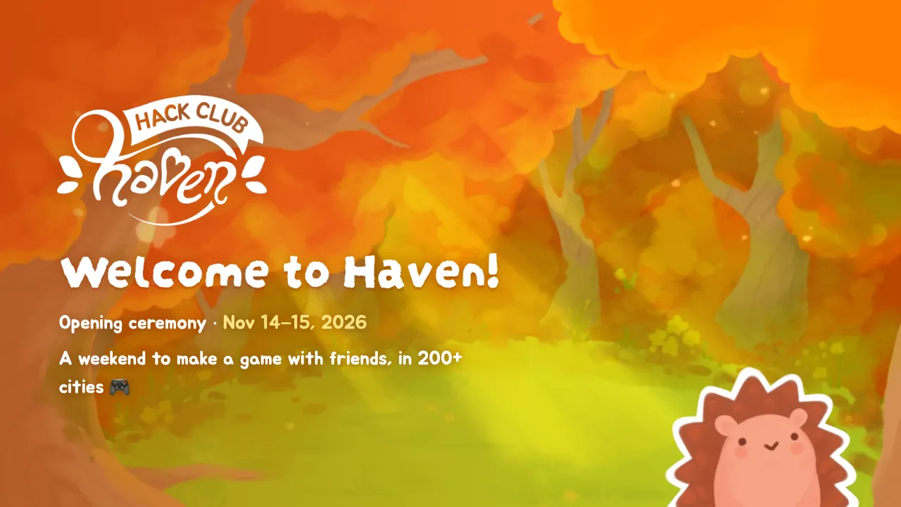

- **Type:** Darumadrop One for headings, Jua for body text (the brand guide's fonts), bundled
  locally so decks work offline
- **Palette:** the brand guide's official colours, plus a few supporting shades from the site
- **Motifs:** wooden signboards with leaf corners, name plaques, white speech bubbles, yellow
  highlighter, orange picnic cards, the spiral notebook, and Daven the hedgehog peeking in

## Use it

```md
---
theme: ./path/to/slidev-theme-haven   # or `haven` once published as slidev-theme-haven
---
```

Run the demo deck ([example.md](example.md)):

```bash
npm install && npm run dev
```

## Palette

From the Haven Brand Guide → Fonts + Colors. Available as CSS variables (`--haven-lime`, …) and
UnoCSS colours (`text-haven-lime`, `bg-haven-banana`, …).

| Role      | Name           | Hex       | Token           |
| --------- | -------------- | --------- | --------------- |
| Primary   | lime green     | `#B8C11F` | `haven-lime`    |
| Primary   | carrot orange  | `#FC8616` | `haven-carrot`  |
| Secondary | banana yellow  | `#F9DD60` | `haven-banana`  |
| Secondary | pumpkin orange | `#E87136` | `haven-pumpkin` |
| Secondary | faded orange   | `#DFA063` | `haven-faded`   |
| Secondary | burnt umber    | `#783D2B` | `haven-umber`   |
| Secondary | lucky green    | `#A8A237` | `haven-lucky`   |

Supporting shades from the site: body text `#ED5615` (`haven-orange-deep`), sign-up button
`#FA681B` (`haven-orange`), highlighter `#FFD059` (`haven-yellow`), signboard wood `#B8774A`
(`haven-brown`), FAQ teal `#2CBF90` (`haven-teal`).

## Layouts

### `cover`
Autumn forest, Haven logo, hedgehog peeking in. Frontmatter: `logo: white | orange | watercolor | false`,
`hedgehog: false`, `background`.


### `default`
Meadow with a cream signboard. The first `# h1` becomes the brown name plaque.

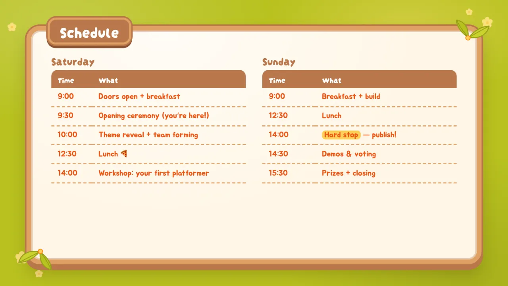

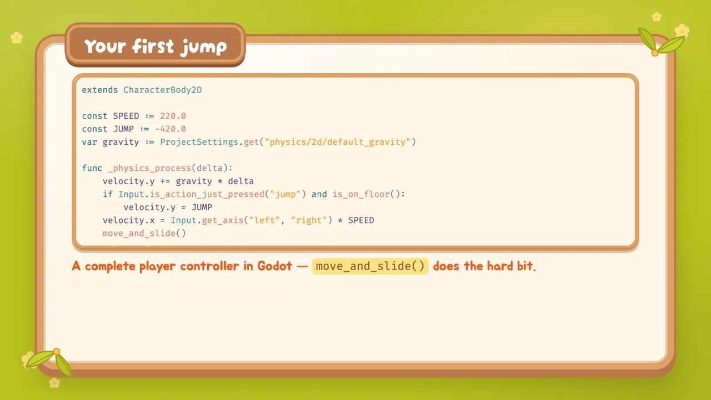

### `center`
A small centred signboard.

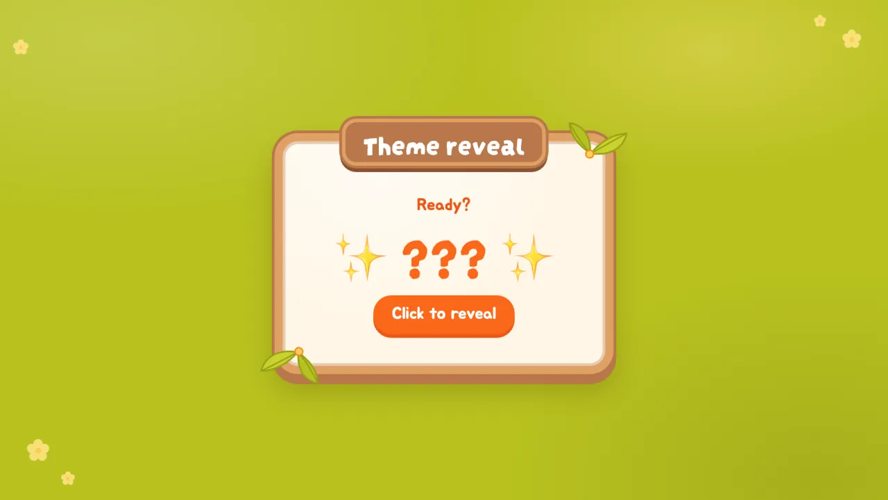

### `two-cols`
Signboard split in two (`::right::`).

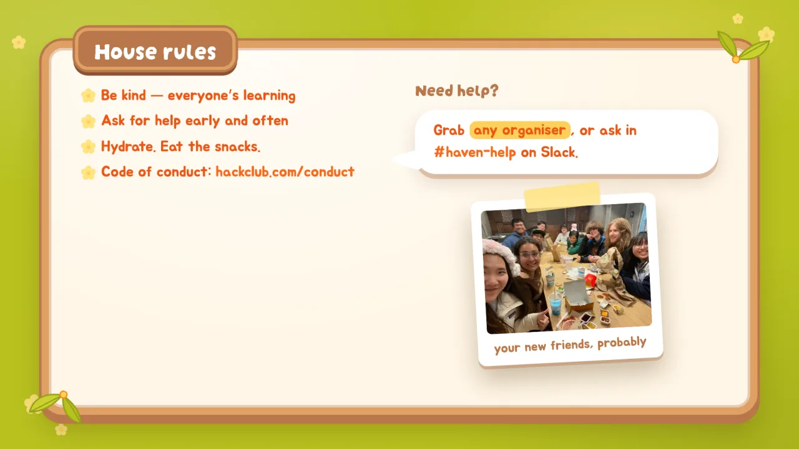

### `image-right` / `image-left`
Signboard plus a taped polaroid. Frontmatter: `image`, `caption`, `tilt`.

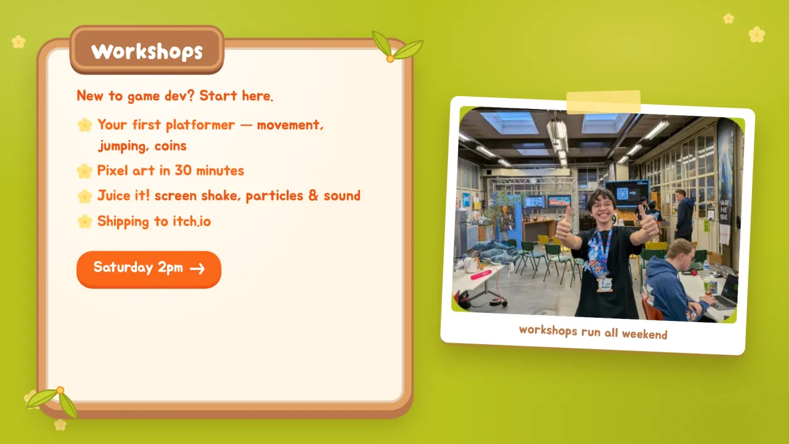

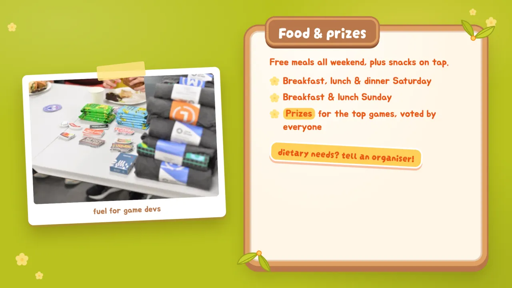

### `intro`
Speaker card with a round avatar. Frontmatter: `avatar` (defaults to Daven).

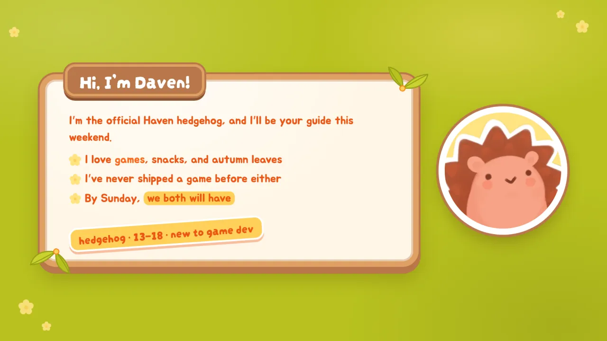

### `section`
A big signboard on the village-path map. Frontmatter: `kicker`, `background`.

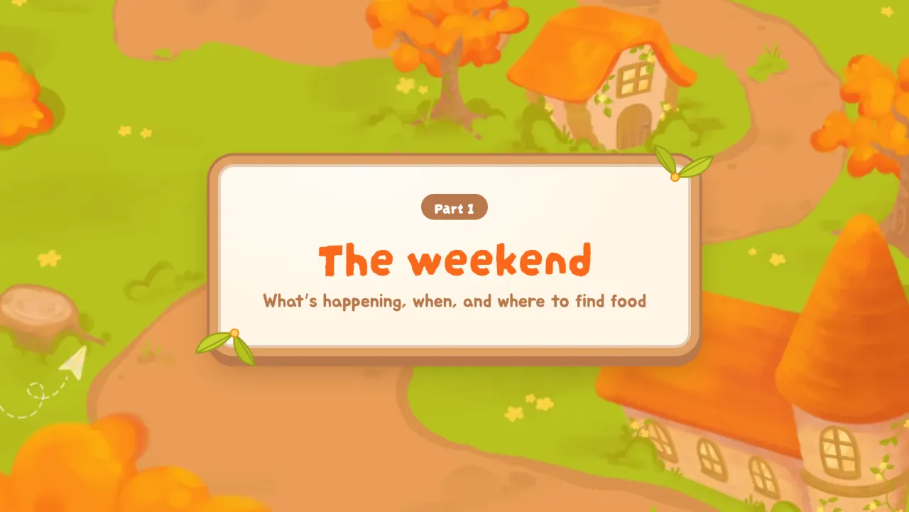

### `notebook`
The site's spiral notebook: the default slot fills the left page, `::right::` fills the right.
Frontmatter: `heading` (white glowing title outside the book). Best with 2 `<Step>`s per page.

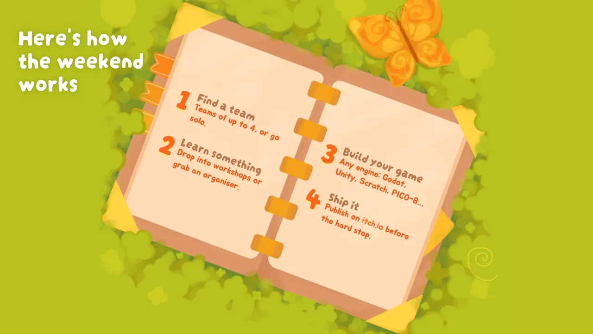

### `statement`
Glowing white headline framed by the site's sparkle marks. Frontmatter: `background`.

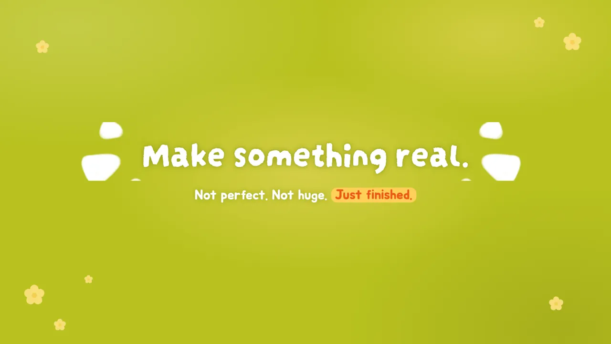

### `bubbles`
Forest + hedgehog; every paragraph or list item becomes a speech bubble.
Frontmatter: `background`, `hedgehog: false`.

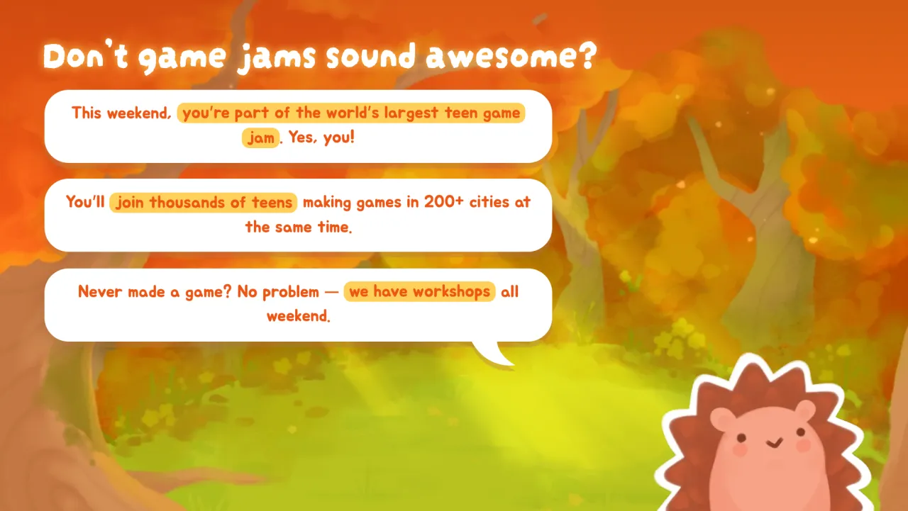

### `quote`
Daven says it: the blockquote is one big speech bubble, a paragraph after it is the attribution.
Frontmatter: `background`, `hedgehog: false`.

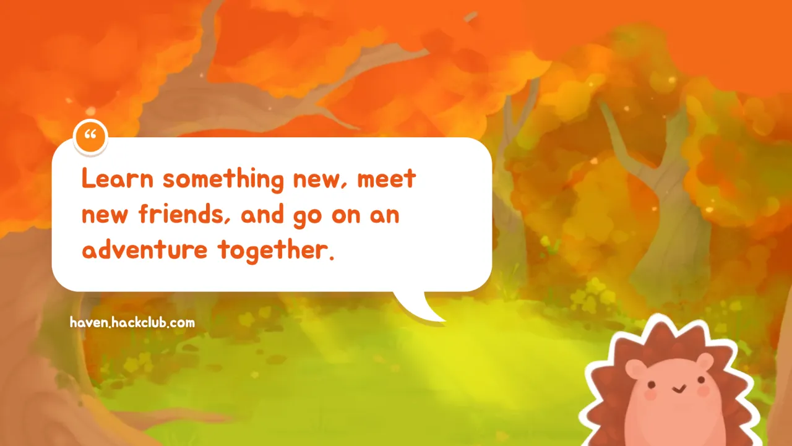

### `cards`
Orange picnic-blanket backdrop for `<HavenCard>` grids. Frontmatter: `background`.

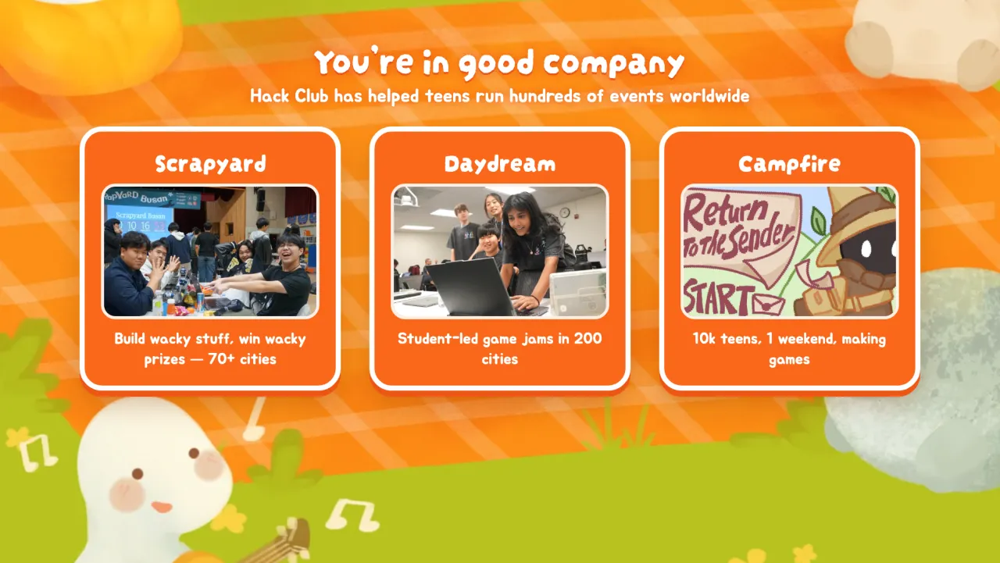

### `fact`
A huge butter-yellow number over the forest. Frontmatter: `background`.

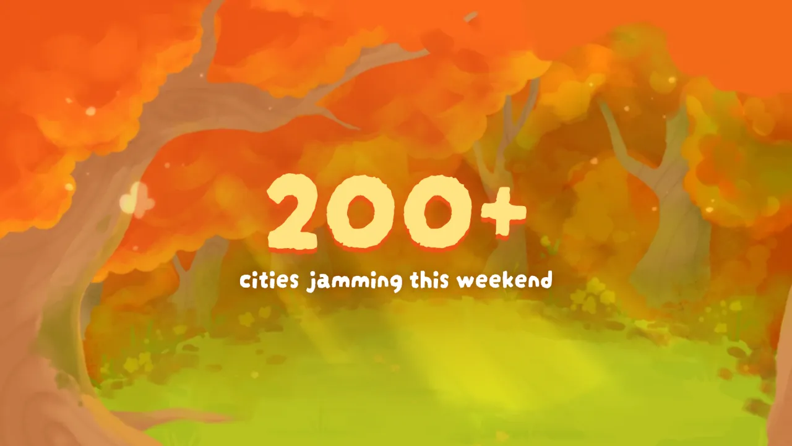

### `end`
Forest + excited hedgehog. Frontmatter: `background`, `hedgehog: false`.

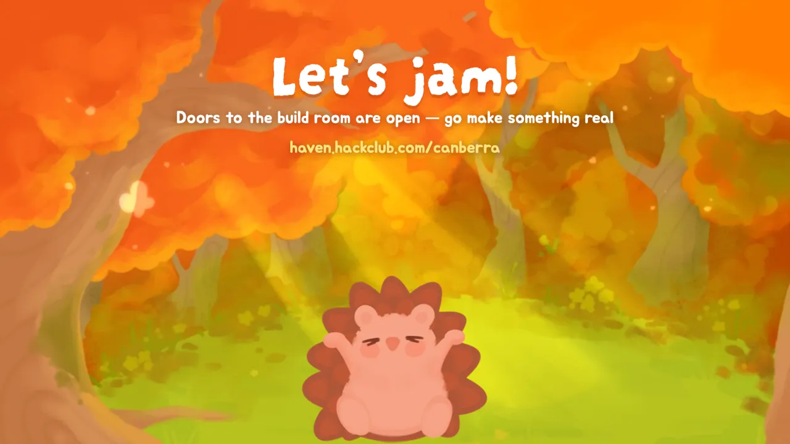

## Components

```md
<mark>highlighted</mark>  or  <Marker>highlighted</Marker>
<HavenCard title="Scrapyard" image="/photos/x.webp" variant="orange|cream|green">body</HavenCard>
<Step n="1" title="Find a team">Teams of up to 4.</Step>
<HavenButton href="https://haven.hackclub.com" arrow>Sign up!</HavenButton>
<Bubble tail="left|right|none">Speech bubble</Bubble>
<Polaroid src="/photos/x.webp" caption="hi" tilt="-3" max-height="10rem" />
<Sticker tilt="-4">new!</Sticker>
<Daven variant="peek|excited|thumbs|pixel" bottom="0" right="40px" width="160px" flip />
```

> `==mark==` syntax isn't enabled in Slidev by default — use `<mark>`.

## Brand rules worth knowing

From the Haven Brand Guide's social media guidelines:

- No AI-generated images.
- Every logo must keep the "Hack Club" mark — all three bundled logos do.

## Notes

- Background art, logos, mascot and UI pieces come from the haven.hackclub.com site and the
  brand guide's asset folders. Photos in `public/photos` are only for the demo deck.
- The demo deck is a generic Haven opening ceremony; its schedule, workshops and food are
  examples to swap for your own event's.
- Slidev 53.0.0's own CSS breaks `slidev build`'s CSS minifier, so [vite.config.ts](vite.config.ts)
  turns CSS minification off.
- Regenerate the screenshots with `npm run screenshot` (needs `npx playwright install chromium`).
